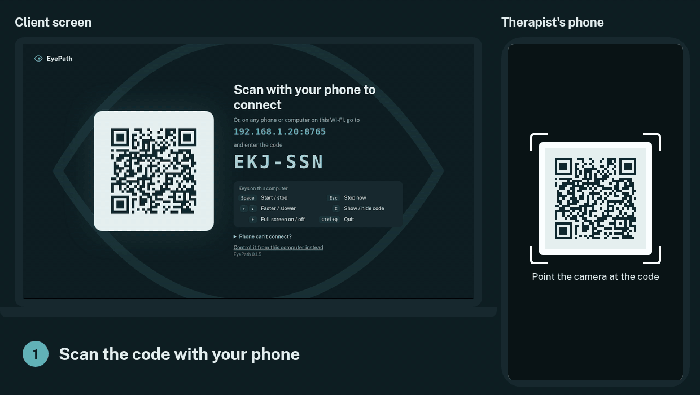
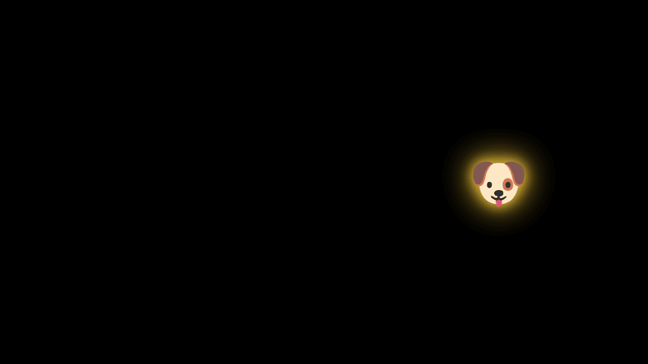
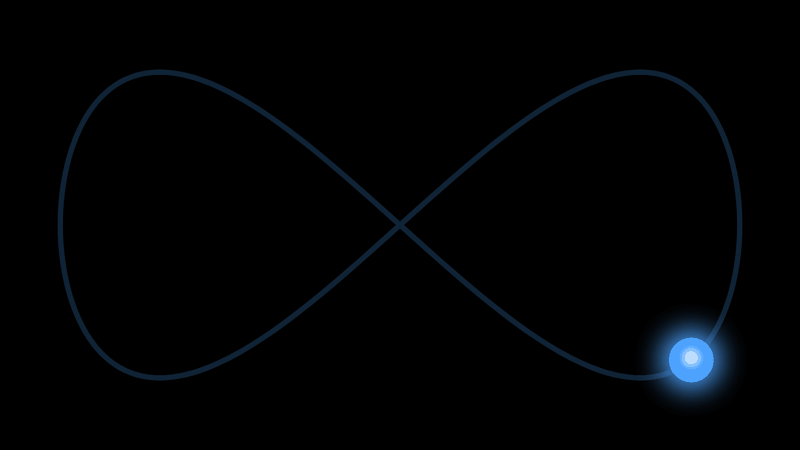
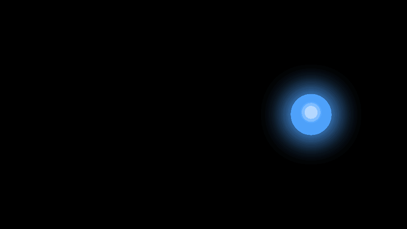

# EyePath

A free, open-source light bar for EMDR therapists, running on the therapist's laptop. A ball moves along a
track on the client's screen, with bilateral sound in headphones, and the
therapist controls it from their phone.

Everything runs on the laptop and the local Wi-Fi. No internet, accounts or
cloud service. The app stores nothing about clients beyond what a therapist chooses to put in a
preset's name (initials are a good idea).

EyePath is a tool for trained EMDR clinicians, not a treatment in itself (see the [disclaimer](#disclaimer)).



## What it looks like

**Fun shapes for children.** Ten pictures, from a dog to a rocket, instead of the light. Animals turn
to face the way they're moving, and the colour setting tints their glow.



**Eight tracks.** Side to side, up and down, both diagonals, and figure 8 and oval in either direction.
The light can glide smoothly, move at a steady pace, or jump from side to side.



**Dual attention (optional).** Numbers, letters or colour flashes appear on the light for the client
to say aloud.



## Using it

1. Open **EyePath** on the laptop. The screen goes full screen and shows a QR code.
2. Scan the QR code with the phone, or type the address shown into the phone's
   browser and enter the 6-character code.
3. The laptop screen turns into the light bar. Everything else is done from the phone.

The light opens full screen with sound ready, no clicks needed. Closing the
window quits the app.

Every time the app opens it shows a new code, and nothing from an earlier
session stays connected, so scan it at the start of each session. During a
session the phone stays connected, even if its screen locks. **Quit** is at the
top of the phone remote.

If the phone dies mid-session, press **C** on the laptop to bring the QR code
back (and C again to hide it).

The laptop never dims, locks or sleeps while the app is running (closing the
lid still sleeps it). It goes back to normal when the app quits.

The laptop itself never needs the code, so the remote can also run there
("Control it from this computer instead" on the QR screen), for example when the
client watches a TV or second monitor. Opening the app again while it's
running just reopens the screen.

### First run

- **Windows** asks whether to allow network access. Choose **Allow** (private networks), or the phone can't connect.
  The installer isn't signed yet, so Windows may show a "Windows protected your PC" screen first:
  choose **More info** → **Run anyway**.
- **Mac**: the app isn't signed with an Apple certificate yet, so the first time, right-click it and choose
  **Open**, or allow it under System Settings → Privacy & Security.
- **iPhone with Chrome, Firefox, Edge or Brave**: the browser needs Local Network permission
  (Settings → Privacy & Security → Local Network) or it silently can't connect. Safari doesn't need it.
- **Guest or clinic Wi-Fi** sometimes blocks devices from reaching each other. If the phone can't connect,
  turn on the phone's hotspot and join the laptop to it.

### Remote controls

- **Start / Stop**: Stop finishes the current sweep, then the ball glides to the centre. **Stop now** glides home straight away.
- **Set length**: a number of passes, a timer, or no limit. A pass is the ball reaching one side.
- **Tracks**: side to side, up and down, both diagonals, and figure 8 and oval in either direction (↺ is reversed). A new track starts with the next set.
  **Height on screen** moves the light up or down (tap **Centre** to reset).
- **Show on**: with more than one screen connected, pick which one shows the light (or press S on the
  computer). It remembers the choice, and a running set carries on while it moves.
- **Light**: shape (circle, star, heart, diamond or square), colour, background, size and glow.
  **Fun shapes** for children: dog, cat, butterfly, fish, turtle, unicorn, rocket, gold star, rainbow
  and ball. Animals turn to face the way they're moving.
- **Speed** is shown in sweeps per second (one side to the other) and in Hz (full back-and-forths per
  second). The default is 1 Hz; lab studies found 1.2 Hz worked better than
  0.8 Hz (van Veen et al., 2015). Speed and edge pause can change during a set without the ball jumping.
- **Movement**: Smooth (slows at each side), Steady, or Jump (snaps from side to side, like the "saccade"
  eye movements that improved memory retrieval in lab studies by Christman and colleagues).
- **Sound**: click or tone on each side, or a sweep that pans with the ball. Use headphones. For Bluetooth
  headphones, raise **Sound delay** (usually 150–250 ms) until the sound lines up with the light.
  **Test sound** plays a tone in the left ear, then the right, with "Left" / "Right" shown on that side of
  the client screen, so the client can check the headphones are the right way round.
  **Left / right balance** turns one ear down for a client who hears less on the other side.
  Saved presets include the sound delay and balance, so a therapist can keep one per client; the
  starter presets leave them as they are.
- **Dual attention** (optional): colour flashes, numbers or letters appear on the light at random
  moments, easy, medium or hard. The client counts the flashes or says each number or letter aloud;
  the answers show under the counter on the remote. Lab studies find that extra working-memory load
  can strengthen the effect of the eye movements, with harder tasks working better (Littel & van Schie,
  2019), and EMDR 2.0, which adds such tasks, did as well as standard EMDR with fewer sets in a
  non-clinical trial (Matthijssen et al., 2021).
- **Set counter**: "Set 3" next to the name at the top of the remote counts the sets started since the app
  opened. It isn't saved and starts again at zero next time.
- **Presets** save the current settings. A fresh install comes with five starter
  presets (Standard, Fast · 1.2 Hz, Slow & short, Sound only, Gentle star);
  delete or replace them as you like.
- **Keyboard** (when the remote is open on a laptop): Space start/stop, Esc stop now, ↑/↓ speed, 1–9 and 0 load presets.
- **Keys on the laptop's light screen**, for when your phone isn't nearby: Space start/stop, Esc stop now,
  ↑/↓ speed, C show/hide the QR code, F full screen on/off, S next screen (with more than one),
  Ctrl+Q (⌘Q on a Mac) quit.
  The QR screen lists them too.

## How it stays smooth

The laptop sends only settings and start/stop times, a few bytes per change.
Each screen syncs its clock with the laptop and works out the ball's position
from the time on every frame, so a slow network or a dropped frame can't make
the ball stutter or drift. Sounds are scheduled on the browser's audio clock
for the moment the ball reaches each side.

## Development

The app is built with [Electron](https://www.electronjs.org/). You need
[Node.js](https://nodejs.org/) 22 or newer.

```sh
npm install          # once
npm start            # run the app (Electron window, full screen)
npm run server       # just the server, no window: open http://localhost:8765/client in a browser
```

Settings and presets are saved in `data/` when run from
source, and in the user's app data folder (`%APPDATA%\EyePath` or
`~/Library/Application Support/EyePath`) when installed.

After changing the pages (`static/`), reload the window (Ctrl+R / Cmd+R).
After changing `server.js` or `main.js`, quit and start again.

### Building the Windows and Mac apps

`.github/workflows/build.yml` builds both on GitHub: run it from the Actions
tab, or push a tag such as `v0.1.0` to attach the downloads to a release.
It makes a Windows installer (`.exe`) and a Mac disk image (`.dmg`) that runs
on both Apple Silicon and Intel Macs. To build by hand on Windows or a Mac:

```sh
npm ci
npm run dist         # result in dist/
```

The version number comes from `package.json`.

## Disclaimer

EyePath is a tool for trained clinicians, not a treatment in itself. It doesn't
diagnose or treat anything on its own and is meant to be used only as part of
therapy with a qualified, EMDR-trained therapist. It is provided as is, without
any warranty (see [LICENSE](LICENSE)).

## License

MIT. See [LICENSE](LICENSE). The QR code generator credits Project Nayuki's
MIT-licensed library; see the note at the top of `qr.js`. The fun-shape pictures are
Google's [Noto Emoji](https://github.com/googlefonts/noto-emoji) (Apache License 2.0); see `static/emoji/`.

## Files

- `main.js`: the Electron app (window, keep-awake, one copy at a time, quit)
- `server.js`: the server (session state, motion timing, pairing, laptop settings)
- `qr.js`: QR code generator
- `build/icon.svg`: the app icon (master drawing); `build/icon.png` and the icons in `static/` are made from it
- `static/common.js`: clock sync, motion maths and drawing, shared by the pages
- `static/audio.js`: bilateral sound
- `static/client.*` (laptop screen, with the QR code), `static/therapist.*` (remote), `static/login.html`
- `docs/`: the website (served by GitHub Pages from this folder) and the demo GIFs and screenshots in `docs/media/`